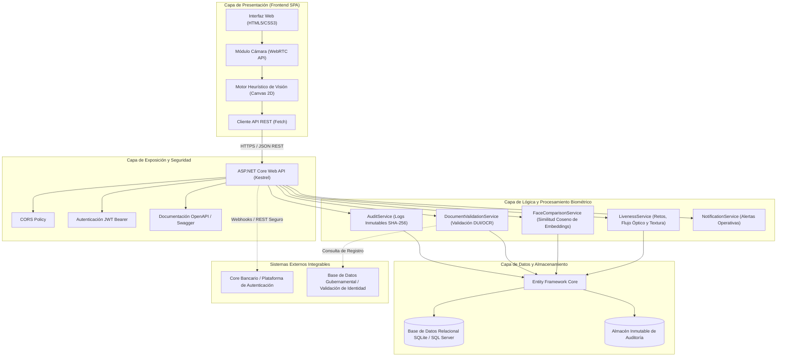
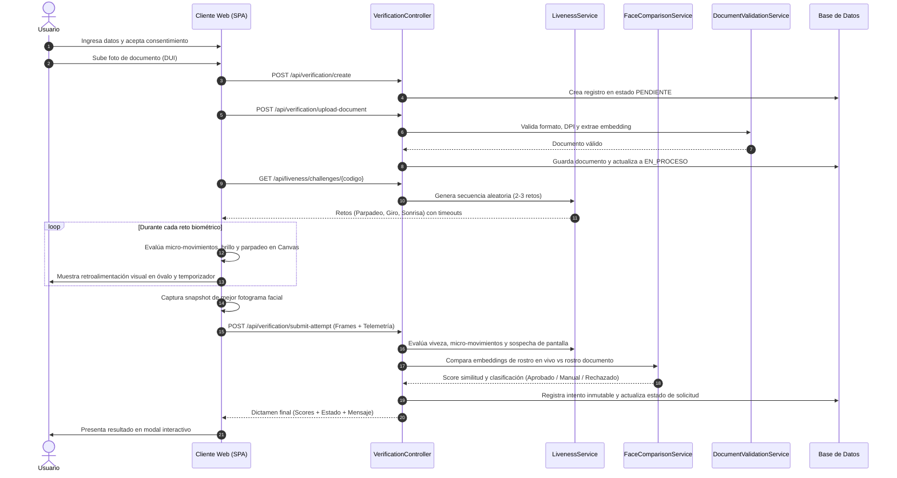
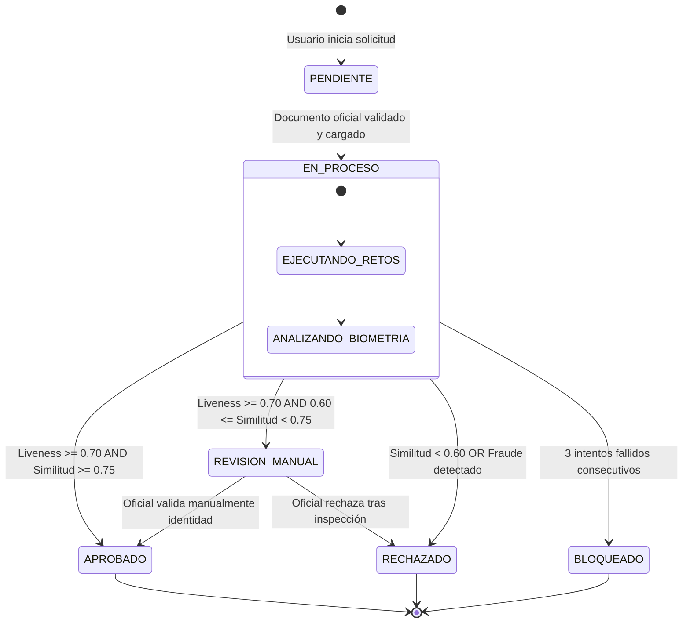

# Diseño de Arquitectura Técnica del Sistema
## Sistema de Pruebas de Vida (Liveness Detection) y Verificación de Identidad
**Proyecto:** Proyect05 - Grupo 4 | CASATIC / UGB

---

### 1. Visión General de la Arquitectura
El sistema adopta una arquitectura en capas basada en microservicios modulares y principios RESTful, con una separación clara entre la interfaz de cliente (Frontend SPA Vanilla / Canvas / WebRTC) y el backend de procesamiento biométrico y de negocio (.NET 8 ASP.NET Core Web API).

---

### 2. Diagrama de Flujo de Verificación (Secuencia)
El siguiente diagrama detalla la interacción paso a paso entre el Usuario, el Frontend, los Servicios Backend y la Base de Datos.

---

### 3. Diagrama de Estados de la Solicitud

---

### 4. Descripción de Componentes Clave

1. **Capa Cliente (Frontend SPA):**
   - Construida en Vanilla JavaScript modular (ES6+), sin sobrecargas de dependencias externas.
   - Utiliza la **WebRTC MediaStream API** para obtener video nativo a 30 FPS.
   - Utiliza la **HTML5 Canvas 2D API** con directiva `willReadFrequently: true` para ejecutar cálculos de visión por computadora en el hilo de renderizado sin congelar la interfaz.
   - Proyecta un óvalo dinámico que cambia de color según la calidad de la iluminación y la distancia.

2. **Capa de Control y Exposición (ASP.NET Core Web API):**
   - Controladores RESTful fuertemente tipados.
   - Generación de contratos interactivos mediante Swagger UI.
   - Políticas CORS restrictivas y middleware de manejo global de excepciones.
   - Autenticación JWT con esquema Bearer para roles administrativos y de auditoría.

3. **Motor de Liveness (C# & JS Híbrido):**
   - En cliente: Detección en tiempo real de parpadeos y giros para guiar al usuario.
   - En servidor: Validación de telemetría inter-frame, distribución temporal y detección de patrones de fraude (ausencia de micro-movimiento o saltos temporales sospechosos).

4. **Motor de Comparación Facial:**
   - Vectorización de rasgos faciales a 128 dimensiones con normalización $L_2$.
   - Comparación mediante producto punto normalizado (Similitud Coseno).
   - Zona gris configurable para mitigar falsos rechazos en fotos antiguas de documentos oficiales.

5. **Servicio Inmutable de Auditoría:**
   - Registro de cada intento, fallo, inicio de sesión y cambio de configuración.
   - Cálculo criptográfico de **SHA-256 encadenado** (cadena de hashes):
     $$\text{Hash}_i = \text{SHA256}(\text{Hash}_{i-1} \parallel \text{SolicitudId} \parallel \text{Evento} \parallel \text{Timestamp})$$
   - Esto garantiza que ningún registro pueda ser alterado retroactivamente sin romper la cadena.
