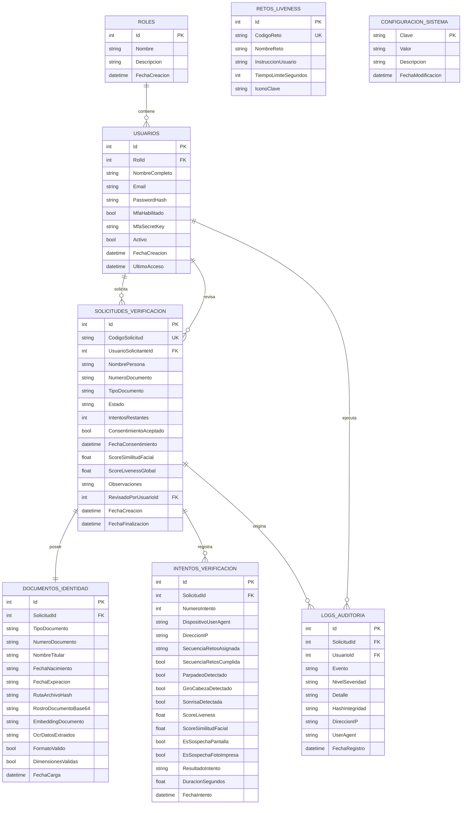

# Modelo de Datos y Diccionario de Base de Datos
## Sistema de Pruebas de Vida (Liveness Detection) y Verificación de Identidad
**Proyecto:** Proyect05 - Grupo 4 | CASATIC / UGB

---

### 1. Diagrama Entidad-Relación (Mermaid)

---

### 2. Diccionario de Datos

#### Tabla: `Roles`
| Campo | Tipo | Nulo | Descripción |
| :--- | :--- | :--- | :--- |
| `Id` | INTEGER | NO | Identificador único (Clave Primaria Autoincremental). |
| `Nombre` | VARCHAR(50) | NO | Nombre único del rol (`Administrador`, `OficialVerificacion`, `UsuarioCliente`). |
| `Descripcion` | VARCHAR(255) | SÍ | Propósito y permisos del rol. |
| `FechaCreacion` | DATETIME | NO | Marca de tiempo UTC de creación. |

#### Tabla: `Usuarios`
| Campo | Tipo | Nulo | Descripción |
| :--- | :--- | :--- | :--- |
| `Id` | INTEGER | NO | Clave Primaria. |
| `RolId` | INTEGER | NO | Clave Foránea referenciando `Roles(Id)`. |
| `NombreCompleto`| VARCHAR(120) | NO | Nombre del usuario administrativo u operador. |
| `Email` | VARCHAR(120) | NO | Correo electrónico único de acceso. |
| `PasswordHash` | VARCHAR(255) | NO | Hash criptográfico seguro (SHA-256 / BCrypt). |
| `MfaHabilitado` | BOOLEAN | NO | Indica si requiere doble factor (TOTP). |
| `Activo` | BOOLEAN | NO | Permite suspender o dar de baja el acceso. |

#### Tabla: `SolicitudesVerificacion`
| Campo | Tipo | Nulo | Descripción |
| :--- | :--- | :--- | :--- |
| `Id` | INTEGER | NO | Clave Primaria. |
| `CodigoSolicitud`| VARCHAR(64) | NO | Código público único alfanumérico (ej: `SOL-A8F3C1D2`). |
| `NombrePersona` | VARCHAR(120) | NO | Nombre del solicitante a verificar. |
| `NumeroDocumento`| VARCHAR(30) | NO | Número de DUI o Pasaporte. |
| `TipoDocumento` | VARCHAR(20) | NO | `DUI`, `PASAPORTE`, `LICENCIA`. |
| `Estado` | VARCHAR(30) | NO | `PENDIENTE`, `EN_PROCESO`, `APROBADO`, `RECHAZADO`, `REVISION_MANUAL`, `BLOQUEADO`. |
| `IntentosRestantes`| INTEGER | NO | Intentos disponibles (inicia en 3). |
| `ConsentimientoAceptado`| BOOLEAN | NO | Confirmación obligatoria de privacidad. |
| `ScoreSimilitudFacial`| REAL | NO | Puntuación normalizada de similitud (0.00 a 1.00). |
| `ScoreLivenessGlobal`| REAL | NO | Puntuación normalizada de prueba de vida (0.00 a 1.00). |

#### Tabla: `IntentosVerificacion`
| Campo | Tipo | Nulo | Descripción |
| :--- | :--- | :--- | :--- |
| `Id` | INTEGER | NO | Clave Primaria. |
| `SolicitudId` | INTEGER | NO | Clave Foránea a `SolicitudesVerificacion(Id)`. |
| `NumeroIntento` | INTEGER | NO | Número correlativo del intento (1, 2 o 3). |
| `DispositivoUserAgent`| VARCHAR(255) | SÍ | Navegador, versión y sistema operativo del solicitante. |
| `DireccionIP` | VARCHAR(64) | SÍ | Dirección IP del cliente en el momento del intento. |
| `SecuenciaRetosAsignada`| TEXT | SÍ | JSON con el listado de retos evaluados. |
| `ScoreLiveness` | REAL | NO | Score de viveza obtenido en este intento específico. |
| `ScoreSimilitudFacial`| REAL | NO | Similitud con el documento en este intento. |
| `ResultadoIntento`| VARCHAR(30) | NO | `EXITOSO`, `FALLIDO_LIVENESS`, `FALLIDO_SIMILITUD`, `FRAUDE_DETECTADO`. |
| `DuracionSegundos`| REAL | NO | Tiempo total transcurrido durante la prueba. |

#### Tabla: `LogsAuditoria` (Inmutable)
| Campo | Tipo | Nulo | Descripción |
| :--- | :--- | :--- | :--- |
| `Id` | INTEGER | NO | Clave Primaria. |
| `Evento` | VARCHAR(80) | NO | Identificador del evento (`INICIO_SESION`, `CARGA_DOCUMENTO`, `INTENTO_EXITOSO`, `FRAUDE_DETECTADO`). |
| `NivelSeveridad`| VARCHAR(20) | NO | `INFO`, `WARNING`, `ERROR`, `CRITICAL`. |
| `Detalle` | TEXT | NO | Descripción textual enriquecida del suceso. |
| `HashIntegridad`| VARCHAR(64) | NO | **Hash SHA-256 encadenado** al log anterior. |

---

### 3. Política de Retención y Privacidad (GDPR)
1. **Minimización de Datos:** Los fotogramas transitorios procesados en el cliente no se almacenan como video completo en el servidor; únicamente se persiste un snapshot de referencia normalizado y su vector de embedding numérico (128 flotantes).
2. **Ciclo de Vida de Datos Biométricos:** El parámetro `DIAS_RETENCION_BIOMETRICA` (por defecto 30 días) es ejecutado por un worker programado que anonimiza o purga las imágenes en Base64 una vez transcurrido el tiempo legal, preservando únicamente el hash y los metadatos de auditoría inmutables.
